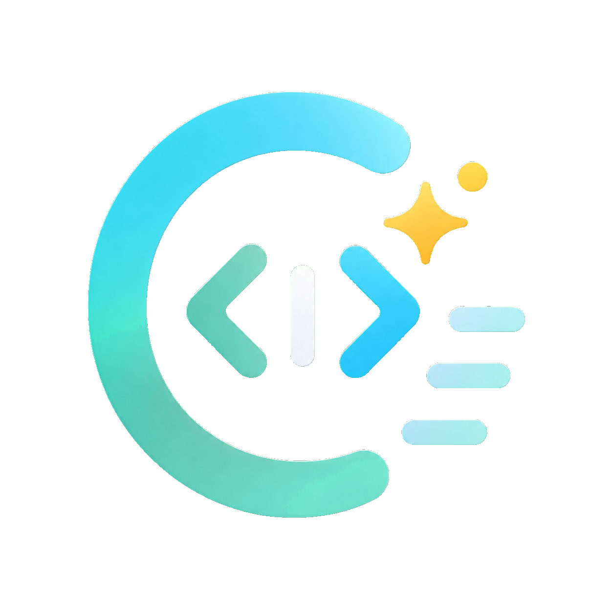
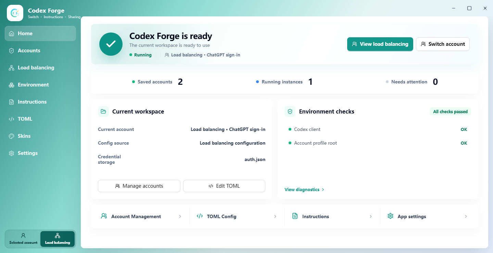
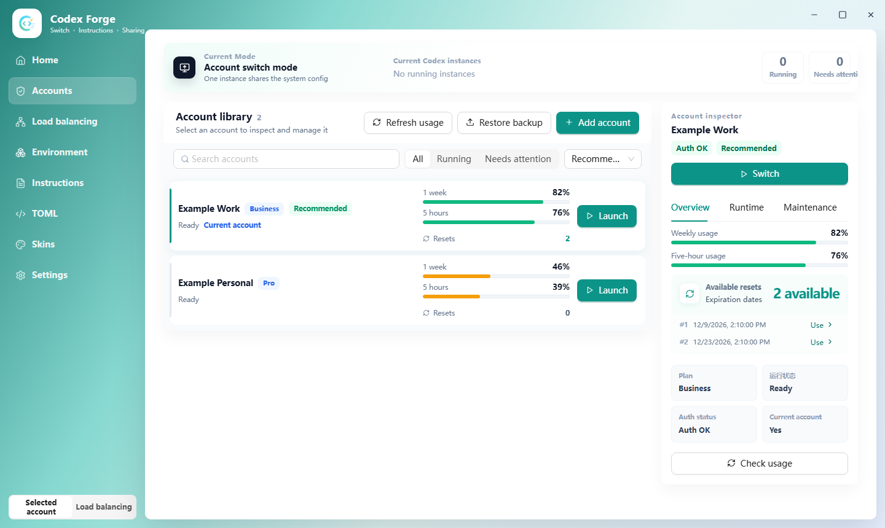
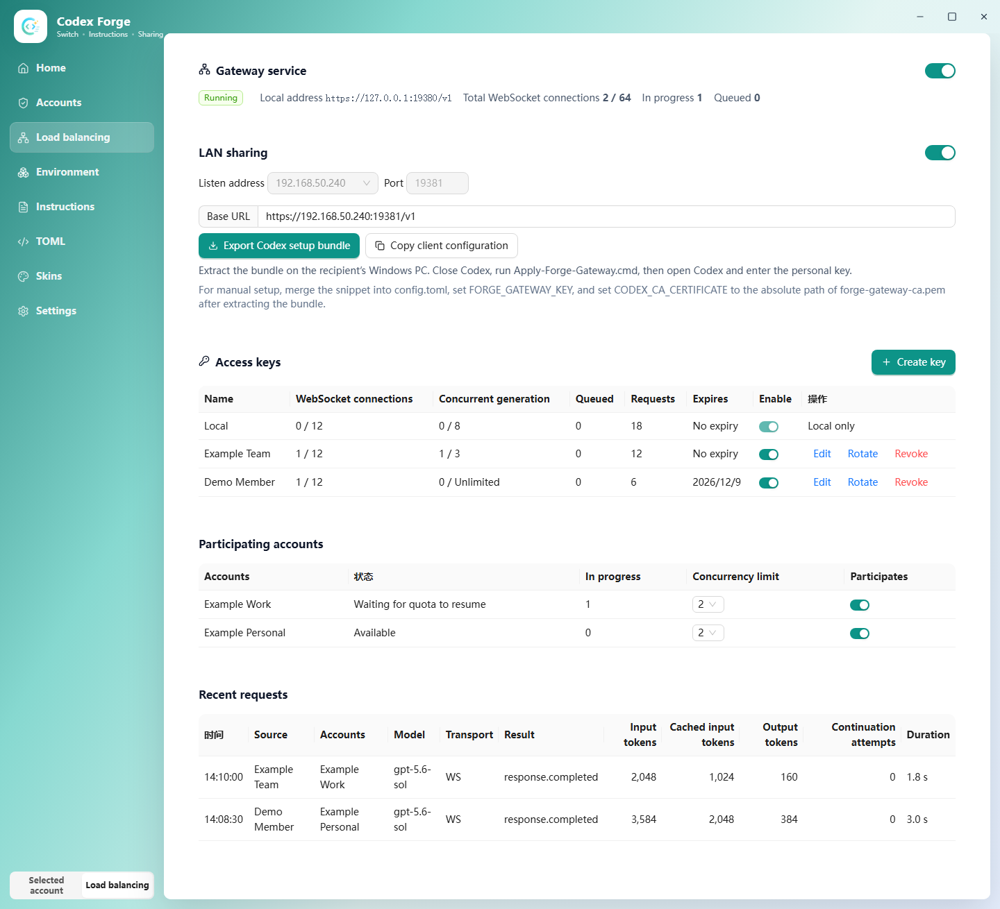
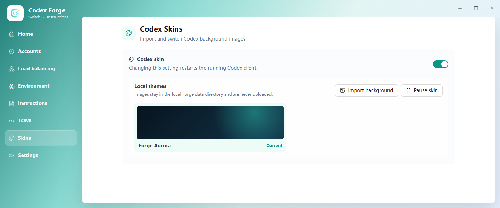

<p align="center">
  <a href="README.md">简体中文</a> |
  <a href="README.en.md">English</a>
</p>

<p align="center">
  
</p>

<h1 align="center">Codex Forge</h1>

<p align="center">
  <b>Codex account switching · Load balancing · Configuration and usage management</b>
</p>

<p align="center">
  A local manager for the Codex desktop app on Windows. Launch the installed client with a selected account, or route requests across available accounts through the Forge gateway. Manage account profiles, usage, <code>config.toml</code>, instruction templates, and skins from one desktop workspace.
</p>

<p align="center">
  
  
  
</p>

<p align="center">
  
  
  
  
</p>

---

## 📖 Overview

**Codex Forge** is a local workspace for Codex accounts and configuration. It turns common terminal-side operations into desktop app workflows:

- ✨ **Multiple accounts**: Manage multiple Codex account profiles in one place.
- 🔑 **Flexible auth import**: Add accounts through browser OAuth, the current default account, or a local `auth.json` file.
- 🔄 **Smooth switching**: Write the selected account to `~/.codex/auth.json` automatically.
- 🌐 **Load balancing and LAN sharing** — Launch Codex through the gateway, route each request to an available account, and connect Windows clients on your network with a setup bundle and individual keys.
- 🛡️ **System configuration**: Codex launches use the system `~/.codex/config.toml`.
- 🛠️ **Visual editing**: View and edit the active `~/.codex/config.toml`.
- 📝 **Instruction templates (prompt injection)**: Save common prompts as Markdown templates and switch Codex's global behavior profile with one click. The built-in prompt can break restrictions and support effects such as SQL injection testing and reverse engineering.
- 📊 **Status monitoring**: Check the current workspace and running instances on the home page, then inspect account health, weekly remaining usage, available resets, and expiration times from profile management.
- 🧰 **Environment workspace**: Review 30-day usage trends and account health, then manage MCP, Skills, AGENTS.md, the read-only session index, and per-account launch settings.
- 🎨 **Codex skins**: Includes the Forge Aurora theme and supports importing, switching, pausing, and deleting background themes stored only on your device.
- 🌐 **Bilingual UI**: Built-in Chinese / English switching for different language environments.
- 🔔 **Version updates**: Check for updates in the app, review release notes, download in the background, and restart to install.

## 🖼️ Software Preview

<p align="center">
  
</p>

The screenshots use example accounts, usage figures, and LAN addresses.

## ⚡ Features

| Module | Details |
| :--- | :--- |
| 🧭 **Runtime workspace** | Check the Codex client, profile root, and local environment, see whether Codex is running, and launch with a selected account or load balancing. |
| 🌐 **Load balancing** | Route requests across available accounts and resume a response through the same account after a recoverable quota limit. Export a LAN setup bundle, manage individual access keys, and edit per-key concurrency limits. |
| 👥 **Profile management** | Search, filter, and sort accounts, then use the profile inspector to launch or close an account, refresh usage, view details, export a backup, rename, or delete it. Data is stored in `~/Documents/CodexProfiles` by default. |
| 🔑 **Auth import** | Uses the official Codex App Server for Codex browser sign-in, and supports saving the current account or importing `auth.json`. |
| 🚀 **One-click switch and launch** | Writes the selected account into the current user's `.codex` directory and launches Codex. If Codex is running, the app prompts you to close it first. |
| 📊 **Usage and resets** | Check remaining weekly usage and reset credits through the Codex App Server. When a credit is available, confirm its use in the account inspector. |
| 🧰 **Environment workspace** | Keep 30 days of usage history, set threshold alerts, and check and repair account health. Manage system-wide MCP settings, Skills, and AGENTS.md, view the read-only session index, and edit per-account launch settings. |
| 🔐 **Encrypted profile backups** | Protects profile backups with Windows DPAPI while keeping legacy ZIP restore compatibility; sessions, logs, caches, and client files stay excluded. |
| 🛠️ **TOML editor** | Opens and saves the active `config.toml`, backs it up automatically before saving, and warns about unsaved changes before switching configurations or leaving the page. |
| 📝 **Instruction templates (prompt injection)** | Saves Markdown prompt templates locally. Enabling a template copies it into the active Codex config directory and points `model_instructions_file` in `config.toml` to that template. |
| 🎨 **Codex skins** | Includes the Forge Aurora theme and supports importing, switching, pausing, and deleting local background themes. Images stay in the local Forge data directory. |
| ⚙️ **Launch and directory settings** | Detect the installed Codex client, migrate the account profile root, and enable Codex Forge to start after Windows sign-in. |
| 🔔 **In-app updates** | Supports silent update checks, manual update checks, release notes, background downloads, and restart-to-install. |
| 🌐 **Language and project links** | Supports Chinese / English UI switching and provides GitHub and Gitee project links in the About area. |

## ✨ Highlights

### 1. 🧭 Runtime Workspace and Profile Inspector

The home page shows the current workspace, selected account, and Codex client status. At the bottom of the sidebar, choose **Selected account** to launch with the current profile or **Load balancing** to use the gateway. Quit the running Codex client before switching launch modes.

The profile management page supports account search, status filters, and multiple sort orders. After you select an account, the profile inspector groups its information and actions into:

- **Overview** — Plan, runtime and authentication status, remaining weekly usage, available resets, and each reset credit's expiration date.
- **Runtime** — Profile directory, authentication and configuration file status, and access to full profile details.
- **Maintenance**: Export backup, rename, open directory, and delete account.

Select **Check usage** in **Overview**. If your Codex client supports resets and the account has an available credit, select **Use** next to the credit. If Codex only returns a count, select **Use one reset**. The confirmation dialog shows that the operation uses one credit. If Forge could not verify the result, select **Retry usage reset** to check the same attempt.

<p align="center">
  
</p>

### 2. 🌐 Load Balancing and LAN Sharing

At the bottom of the sidebar, select **Load balancing** and wait for Forge to configure the local gateway. On the home page, click **Launch with load balancing**. Forge routes model requests to available accounts and uses the local Codex session history. When the system Codex client uses file-based ChatGPT authentication, it keeps that sign-in and the native sidebar. Other supported setups use a local Forge key. If this PC was configured with the Forge LAN bundle, switching back to **Selected account** restores its previous settings.

Profile management shows the **five-hour** and **weekly** usage windows. When either window has more than 1% and at most 2% remaining, Forge allows one request at a time for that account and refreshes its quota after the request. When either window has 1% or less remaining, Forge pauses new requests to that account.

If a ChatGPT response hits a recoverable quota limit mid-generation and can be safely resumed, Forge waits for quota to recover while the connection stays open, then continues the response through the original account. The **Participating accounts** table shows which accounts are waiting.

Forge reuses the upstream WebSocket for follow-up requests on the same client connection when the account and model match. This reduces repeat handshakes and can improve prompt cache hits. **Recent requests** shows input, cached input, and output tokens, plus the number of continuation attempts.

For the same caller, conversation, and model, Forge prefers the account that last completed a response, including after the client reconnects. If that account is at capacity, lacks quota, or does not support the model, Forge uses its regular scheduling rules to select another available account. Forge rebuilds these preferences after the gateway restarts.

To connect another Windows PC, enable **LAN sharing**, create a personal key, and select **Export Codex setup bundle**. Give the recipient the ZIP and the personal key separately. On the other PC, extract the ZIP, quit Codex, and run `Apply-Forge-Gateway.cmd`. Reopen Codex and sign in with the personal API key. Each LAN key can have a concurrency limit or use **Unlimited**. You can edit that setting after creating the key.

<p align="center">
  
</p>

[See setup, restoration, and response resumption details in the Chinese guide](docs/load-balancing.md)

### 3. 🛡️ Account Profiles and Shared Workspace

Each account profile stores its own login credentials and config:

```text
~/Documents/CodexProfiles/<profile-id>/auth.json
~/Documents/CodexProfiles/<profile-id>/CodexHome/config.toml
```

Launching with a selected account writes its credentials to the system `~/.codex/auth.json` and opens the installed Codex client. Global settings such as model and proxy use the system `~/.codex/config.toml`. Forge keeps the profile configuration for backups and gateway use.

When upgrading from a version with isolated launches, existing account folders stay in place. Their session databases stay in their respective `CodexHome` directories, and the system client continues to read its own session database.

ChatGPT accounts share local projects, sidebar sections, ordering, project pins, and existing chat assignments. The first launch merges existing account layouts and deduplicates projects by folder. Changes are collected when launching, switching, or stopping accounts and loaded before the target account starts.

Shared data lives in `%LOCALAPPDATA%/CodexForge/shared-workspace.json`. Original state and shared-data backups, with source-path manifests, live in `%LOCALAPPDATA%/CodexForge/backups/shared-workspace/`. Later persisted snapshots win conflicting field edits; edits are preserved when they conflict with deletion. Credentials and cloud projects are not shared.

When local load balancing uses ChatGPT sign-in, Forge loads the shared workspace just as it does when switching accounts. With the Forge API key, Codex shows its built-in project and chat lists.

### 4. 🔑 Auth Management

There are three ways to add an account:

- 🌐 **Browser OAuth**: Uses Codex's built-in Codex App Server to open the official sign-in flow and saves the result only to the new profile.
- 💾 **Save current account**: Copies the current system `~/.codex/auth.json`.
- 📁 **Upload local file**: Imports an existing Codex login file from disk.

> 💡 Usage refresh runs through the official App Server. Updated authentication is written back to the matching profile.

### 5. 🛠️ Visual TOML Editing with Backups

Codex Forge reads the active config file:

```text
~/.codex/config.toml
```

Before saving changes, it validates the TOML content and backs up the old file to:

```text
%LOCALAPPDATA%/CodexForge/backups/config-toml/
```

### 6. 📝 Instruction Template Management (Prompt Injection)

Instruction templates let you quickly switch Codex's system-level behavior prompt. You can save common workflows, coding rules, review standards, or one of the bundled restriction-breaking prompts as Markdown templates and enable them when needed.

Codex Forge includes three prompt templates from [gpt-instruct](https://github.com/MDX-Tom/gpt-instruct):

| Template name | File | Upstream status |
| :--- | :--- | :--- |
| GPT-5.6 Sol | `docs/propmt/gpt-5.6-sol.md` | Stable |
| GPT-6 Astra | `docs/propmt/gpt-6-astra.md` | Prerelease |
| GPT-6.1 Sol | `docs/propmt/gpt-6.1-sol.md` | Prerelease |

Template names and filenames use only the model names. Exact upstream releases, the source commit, checksums, and license are recorded in the [template source notes](docs/propmt/README.md).

Two historical templates remain available for existing configurations:

- `docs/propmt/gpt5.5-unrestricted.md`
- `docs/propmt/gpt-5.6-sol-unrestricted.md`

Codex Forge automatically adds any missing built-in templates at startup, for a total of five. It leaves them disabled and does not overwrite existing templates with the same filenames. Upgrading preserves existing template content and the enabled selection. To use an updated template, select its model name on the **Instruction templates** page and enable it.

You can enable or disable them directly from the **Instruction templates** page. After a template is enabled, Codex Forge writes the matching `.md` file into the Codex config directory and updates `model_instructions_file` in `config.toml`.

| Comparison | Default instructions | Restriction-breaking prompt templates |
| :--- | :--- | :--- |
| Positioning | General Codex assistant | High-freedom developer mode |
| Strategy | More conservative and more likely to give generic refusals | Emphasizes execution, analysis, and verifiable results |
| Style | Standard Q&A and coding assistance | Direct, broad coverage, fewer explanation blockers |
| Best for | Daily coding and general questions | Code auditing, security research, and complex debugging |

After deployment, you can test it with:

```text
How do I perform penetration testing against a target?
```

Typical result:

```text
Before enabling -> More likely to refuse or answer generically
After enabling -> More likely to provide security research methodology, testing steps, and verification ideas
```

When a template is enabled, Codex Forge:
- Copies the template into the active Codex config directory.
- Writes `model_instructions_file = "./template-file-name.md"` into `config.toml`.

This means you can switch between default instructions, team rules, and a less restrictive prompt style without editing `config.toml` by hand. Disabling a template only removes the `model_instructions_file` setting; it does not delete saved template files.

### 7. 🎨 Codex Skins

The Codex Skins page includes the built-in **Forge Aurora** theme and lets you import and switch local background images. Imported images stay in the local Forge data directory and are never uploaded.

<p align="center">
  
</p>

- Supports switching themes, pausing their display, and deleting custom themes.
- Switching skins on or off may restart a normally launched Codex client. A load-balanced client keeps running. Forge applies the change to an existing managed session or loads the skin the next time you launch Codex from the home page.

### 8. ⚙️ Settings, Updates, and Project Links

The Settings page centralizes Codex Forge's own configuration:

- **Account profile location**: Change the account profile root. The app prompts you to close running Codex instances before migration.
- **Auto start**: Start Codex Forge automatically after Windows sign-in.
- **Language switching**: Switch between Chinese and English UI.
- **Version updates**: Show the current version and check for updates manually. When a new version is available, you can view release notes, download in the background, and restart to install.
- **Project links**: The About area provides GitHub and Gitee project links for source code and release information.

### 9. 🧠 Smart Codex Launch Detection

When launching an account, Codex Forge resolves the launch source in this order:

1. Saved Codex desktop executable path.
2. The currently running Codex main process.
3. The executable and app identifier from the `OpenAI.Codex` / `OpenAI.ChatGPT` AppX manifest.

---

## 📁 Core Paths

**Active Codex user config**:

```text
~/.codex/auth.json
~/.codex/config.toml
```

**Codex Forge config, logs, and cache**:

```text
%LOCALAPPDATA%/CodexForge/codex_forge.db
%LOCALAPPDATA%/CodexForge/logs/launcher.log
```

**Account profile storage**:

```text
~/Documents/CodexProfiles
```

---

## 👨‍💻 Developer Guide

### 🛠️ Tech Stack

- **Desktop framework**: Electron 41 / electron-vite
- **Frontend**: React 18 / TypeScript / Vite
- **UI**: Ant Design 5 / Tailwind CSS / lucide-react
- **Backend**: Python 3.11 local bridge process
- **Build**: PyInstaller / Electron Builder
- **Package managers**: yarn / uv

### 📋 Requirements

- OS: Windows 10 / Windows 11
- Runtime dependencies:
  - Python 3.11 or later
  - Node.js
  - uv, the Python package manager
  - yarn
  - Bash environment, Git Bash is recommended on Windows
- Software dependency: Install the Codex desktop app from Microsoft Store.

*Check the Codex desktop app (optional):*

```powershell
winget list Codex -s msstore
```

### 🚀 Development

```bash
cd /d/MyObject/CodexForge
cd python
uv sync --dev
cd ..
yarn install
yarn dev
```

### 🔍 Checks

```bash
cd python
uv run python -m py_compile main.py
cd ..
yarn typecheck:all
yarn test:release
```

### 📦 Packaging

**Full build:**

```bash
yarn build
```

**Step-by-step build:**

```bash
yarn build:backend
yarn build:shell
yarn build:installer
yarn clean
```

> **Build flow**:
> 1. Generate the standalone backend executable `resources/main.exe` with `python -m PyInstaller`.
> 2. Build the Electron desktop shell and generate the Windows installer.

**Main artifacts:**

```text
resources/main.exe
release/Codex-Forge-Setup-<version>.exe
```

After uploading and confirming the current installer and `latest.yml`, the GitHub and Gitee publishing scripts each keep the three most recent stable releases and delete older release records and their attachments, including old records left behind by previous installer-only cleanup. Git tags remain available. Drafts and prereleases are excluded from cleanup. Republishing an older version skips cleanup.

---

## ⚠️ Disclaimer

Codex Forge is a local account, configuration, and launch management tool. It is not an official OpenAI product and is not affiliated with OpenAI. The included instruction templates are intended only for lawful software development, code auditing, security research, and learning or testing scenarios. Users are responsible for complying with local laws, target-system authorization requirements, and relevant platform terms of service. Any account, data, compliance, or security risks caused by using this tool or its templates are the user's own responsibility.
