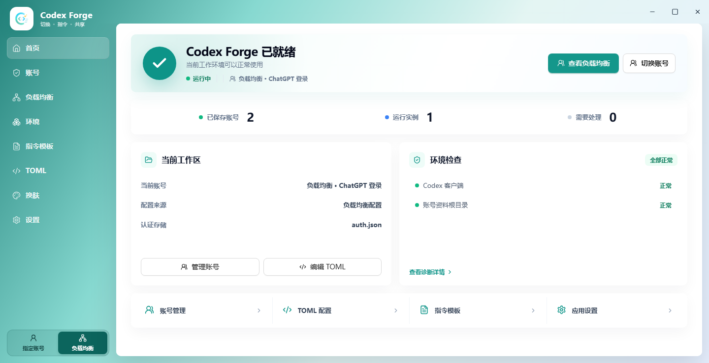
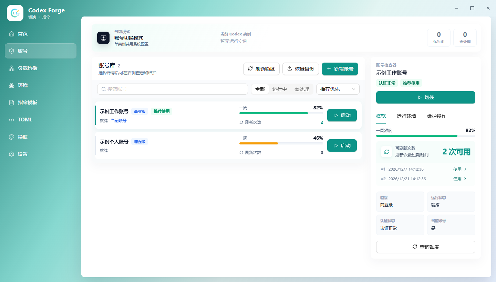
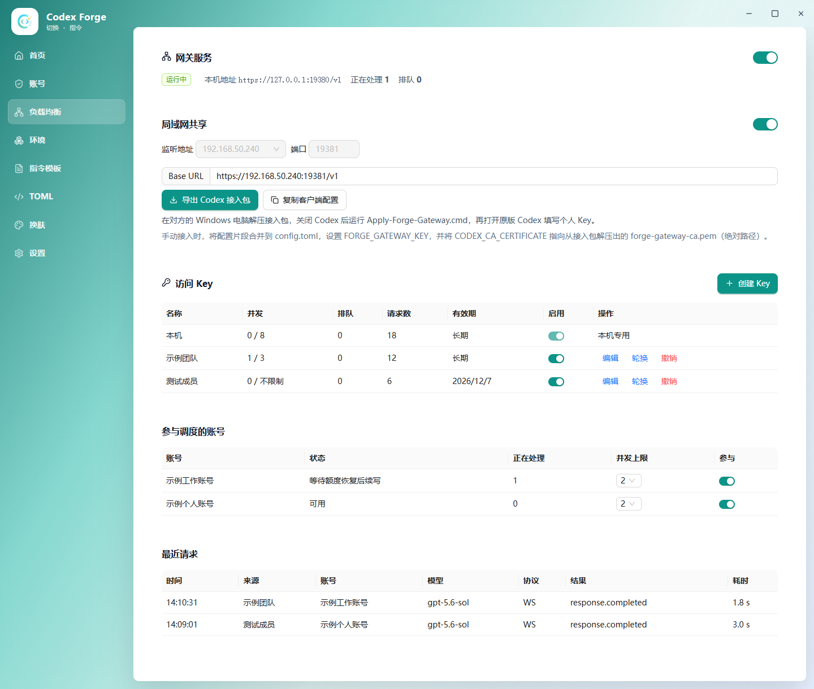
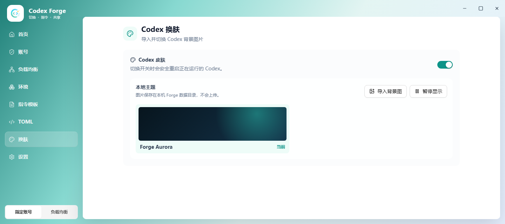

<p align="center">
  <a href="README.md">简体中文</a> |
  <a href="README.en.md">English</a>
</p>

<p align="center">
  
</p>

<h1 align="center">Codex Forge</h1>

<p align="center">
  <b>Codex 多账号切换 · 负载均衡 · 配置与额度管理</b>
</p>

<p align="center">
  面向 Windows Codex 桌面应用的本地管理工具。可以用指定账号启动系统安装的 Codex，也可以通过 Forge 网关在可用账号间分配请求。账号资料、额度、<code>config.toml</code>、指令模板和换肤统一在一个桌面工作台中管理。
</p>

<p align="center">
  
  
  
</p>

<p align="center">
  
  
  
  
</p>

---

## 📖 简介

**Codex Forge** 是一个面向 Codex 桌面应用的**本地多账号与配置工作台**。它将日常高频的终端操作转化为直观的桌面应用功能：

- ✨ **多账号管理**：集中管理多个 Codex 账号资料。
- 🔑 **灵活授权**：支持通过浏览器授权、保存当前默认账号，或导入本地 `auth.json` 来新增账号。
- 🔄 **无缝切换**：切换账号时自动写入当前用户的 `~/.codex/auth.json`。
- 🌐 **负载均衡与局域网共享**：从首页通过网关启动 Codex，按请求调度账号。局域网内的 Windows 客户端可使用接入包和独立 Key 接入。
- 🛡️ **系统配置**：切换账号后，Codex 继续使用系统 `~/.codex/config.toml`。
- 🛠️ **可视化编辑**：提供查看和编辑当前生效的 `~/.codex/config.toml` 的可视化界面。
- 📝 **指令模板（提示词注入）**：把常用提示词保存成 Markdown 模板，一键切换 Codex 的全局行为设定，使用内置提示词可实现破除限制，可实现 SQL 注入测试、逆向等效果。
- 📊 **状态监控**：在首页检查当前工作环境和运行实例，并在账号管理页查看账号健康状态、一周剩余额度、可刷新次数及过期时间。
- 🧰 **环境工作台**：查看30天额度趋势和账号健康检查，并管理 MCP、Skills、AGENTS.md、会话索引与账号启动环境。
- 🎨 **Codex 换肤**：内置 Forge Aurora 主题，支持导入、切换、暂停和删除仅保存在本机的背景主题。
- 🌐 **双语界面**：内置中文 / English 切换，适合不同语言环境下使用。
- 🔔 **版本更新**：支持应用内检查更新、查看更新内容、后台下载并重启安装。

## 🖼️ 软件预览

<p align="center">
  
</p>

截图中的账号、额度和局域网地址均为示例。

## ⚡ 功能特性

| 功能模块                      | 详细说明                                                                                                                                              |
| :---------------------------- | :---------------------------------------------------------------------------------------------------------------------------------------------------- |
| 🧭 **运行工作台**             | 检查 Codex 客户端、账号目录和当前环境，查看运行状态，并选择指定账号或负载均衡启动。 |
| 🌐 **负载均衡** | 按请求调度可用账号，支持在可恢复的额度限制后从原账号续写。局域网共享支持导出接入包，以及创建、编辑并发上限、轮换和撤销访问 Key。 |
| 👥 **账号资料管理**           | 支持搜索、筛选和排序账号，并通过账号检查器集中完成启动、关闭、额度刷新、详情查看、备份、改名和删除，数据默认保存在 `~/Documents/CodexProfiles`。       |
| 🔑 **授权导入**               | 通过官方 Codex App Server 完成 Codex 浏览器登录，也支持保存当前账号或导入本地 `auth.json`。                                                        |
| 🚀 **一键切换启动**           | 切换账号时自动写入当前用户 `.codex` 目录并启动 Codex。若检测到 Codex 正在运行会提示先关闭。                                                  |
| 📊 **额度查询与重置**         | 通过 Codex App Server 查询一周剩余额度和重置权益。账号有可用权益时，可以在账号检查器中确认使用。 |
| 🧰 **环境工作台**             | 保留 30 天额度历史，提供阈值提醒和账号健康检查，支持修复常见问题。可管理系统 Codex 的 MCP、Skills 和 AGENTS.md，查看只读会话索引并设置账号启动环境。 |
| 🔐 **加密账号备份**           | 账号备份使用当前 Windows 用户的 DPAPI 加密，继续兼容恢复旧版 ZIP；会话、日志、缓存和客户端程序不会进入备份。                                        |
| 🛠️ **TOML 编辑**              | 直接查看和保存当前生效的 `config.toml`，保存前自动备份；切换配置或离开页面时会提醒尚未保存的修改。                                                     |
| 📝 **指令模板（提示词注入）** | 本地保存 Markdown（标记语言）提示词模板，启用后复制到当前 Codex 配置目录，并把 `config.toml` 的 `model_instructions_file` 指向该模板。              |
| 🎨 **Codex 换肤**             | 内置 Forge Aurora 主题，支持导入、切换、暂停和删除本地背景主题；图片只保存在本机 Forge 数据目录。                       |
| ⚙️ **启动与目录设置**         | 支持重新识别 Codex 客户端、迁移账号资料根目录，并可开启 Windows 登录后自动启动 Codex Forge。                                                                 |
| 🔔 **应用内更新**             | 支持静默检查新版本、手动检查更新、查看发布说明、后台下载更新包并重启安装。                                                                            |
| 🌐 **语言与项目入口**         | 支持中文 / English 界面切换，并在关于区域提供 GitHub 与 Gitee 项目入口。                                                                               |

## ✨ 核心亮点

### 1. 🧭 运行工作台与账号检查器

首页展示当前工作环境、所选账号和 Codex 运行状态。选择 **指定账号** 可按当前登录资料启动，也可以切换到 **负载均衡** 通过网关启动。更换启动方式前，需要退出正在运行的 Codex。

账号管理页提供账号搜索、状态筛选和多种排序方式。选择账号后，右侧账号检查器会集中展示：

- **概览**：账号套餐、运行与认证状态、一周剩余额度、可刷新次数及各张重置卡的到期时间。
- **运行环境**：账号目录、认证文件和配置文件状态，可打开目录或查看完整详情。
- **维护操作**：导出备份、改名、打开目录和删除账号。

在 **概览** 中点击 **查询额度**。如果 Codex 客户端支持重置且账号有可用权益，可在 **可刷新次数** 中点击卡片旁的 **使用**。只有次数时，点击 **使用 1 次**。确认框会提示本次操作将消耗 1 次权益。若提交结果未能确认，可以点击 **重试重置额度** 核对同一次操作。

<p align="center">
  
</p>

### 2. 🌐 负载均衡与局域网共享

在首页选择 **负载均衡**，等待 Forge 完成网关配置，再点击 **使用负载均衡启动**。Forge 通过可用账号处理模型请求，并沿用本机 Codex 的会话历史。系统 Codex 使用文件存储的 ChatGPT 登录时，沿用该登录和原生侧栏。其他受支持的环境使用本机专用 Forge Key。若此前用 Forge 局域网接入包配置过本机，切回 **指定账号** 时会恢复接入前的设置。

账号页显示 **5 小时额度** 和 **一周额度**。任一窗口剩余超过 1% 且不超过 2% 时，同一账号一次只接一个请求，完成后复查额度。任一窗口剩余 1% 或更低时，Forge 暂停向该账号派发新请求。

回答中途遇到可恢复的 ChatGPT 额度限制且满足续写条件时，Forge 会在连接保持期间等待额度恢复，再用原账号继续当前回答。等待状态可在 **参与调度的账号** 中查看。

同一客户端 WebSocket 连接上的后续请求，如果使用相同账号和模型，Forge 会复用上游连接，以减少重复握手并改善提示词缓存命中。**最近请求** 显示输入、缓存命中和输出 Token，以及续写次数。

同一使用者在同一会话中继续使用同一模型时，Forge 优先选择上次成功生成的账号，客户端重连后也适用。原账号并发已满、额度不足或不支持该模型时，Forge 使用常规调度选择其他可用账号。网关重启后会重新记录会话偏好。

要接入另一台 Windows 电脑，在 **负载均衡** 页启用 **局域网共享**，创建个人 Key 并 **导出 Codex 接入包**。将 ZIP 和个人 Key 分别交给接收方。接收方解压 ZIP、退出 Codex，再运行 `Apply-Forge-Gateway.cmd`，然后重新打开 Codex 并使用个人 Key 登录。每个局域网 Key 可设置并发上限，也可选 **不限制**，创建后可单独编辑。

<p align="center">
  
</p>

[查看接入、恢复配置与续写条件](docs/load-balancing.md)

### 3. 🛡️ 账号资料与共享工作区

每个账号资料独立保存自身的登录凭证与配置：

```text
~/Documents/CodexProfiles/<profile_id>/auth.json
~/Documents/CodexProfiles/<profile_id>/CodexHome/config.toml
```

指定账号启动时，Forge 将所选账号写入系统 `~/.codex/auth.json`，再打开系统安装的 Codex。模型、代理等全局配置使用系统 `~/.codex/config.toml`。账号目录中的配置供备份和网关使用。

从支持隔离启动的版本升级后，旧账号目录中的数据仍保存在原处。旧会话数据库留在各自的 `CodexHome`，系统客户端继续读取自己的会话数据库。

ChatGPT 登录账号共用一份本地工作区布局，包括项目、分区、排序、项目置顶和已有聊天归属。首次启动会合并本机各账号的现有布局，按项目目录去重；后续启动、切换或关闭账号时汇总变更，并在启动前加载到目标账号。

共享数据保存在 `%LOCALAPPDATA%/CodexForge/shared-workspace.json`，原始状态和共享数据的备份保存在 `%LOCALAPPDATA%/CodexForge/backups/shared-workspace/`，每份备份附有原路径清单。同一字段的冲突以较晚落盘的快照为准，删除与修改冲突时优先保留修改。登录凭证和云端项目不参与共享。

本机负载均衡沿用 ChatGPT 登录时，也会按账号切换的方式载入共享工作区。使用 Forge Key 启动时，Codex 显示自带的项目和会话列表。

### 4. 🔑 多样化的认证（Auth）管理

提供三种便捷的新增账号方式：

- 🌐 **浏览器授权**：通过 Codex 内置 Codex App Server 打开官方授权流程，授权结果仅保存至新账号资料目录。
- 💾 **保存当前账号**：一键复制当前系统中的 `~/.codex/auth.json`。
- 📁 **上传本地文件**：从本地选择已有的 Codex 登录文件进行导入。

> 💡 额度刷新通过官方 App Server 完成；如果认证被刷新，最新信息会回写至对应账号资料。

### 5. 🛠️ TOML 可视化编辑与安全备份

Codex Forge 会读取当前生效的配置文件：

```text
~/.codex/config.toml
```

在保存任何修改前，系统会自动校验 TOML 内容的合法性，并将旧文件安全备份至：

```text
%LOCALAPPDATA%/CodexForge/backups/config-toml/
```

### 6. 📝 指令模板管理（提示词注入）

指令模板用于快速切换 Codex 的系统级行为提示词。你可以把常用工作方式、代码规范、审查标准，或仓库内置的破除限制提示词保存为 Markdown（标记语言）模板，需要时一键启用。

Codex Forge 当前内置来自 [gpt-instruct](https://github.com/MDX-Tom/gpt-instruct) 的三份提示词模板：

| 模板名称 | 文件 | 上游状态 |
| :--- | :--- | :--- |
| GPT-5.6 Sol | `docs/propmt/gpt-5.6-sol.md` | 稳定版 |
| GPT-6 Astra | `docs/propmt/gpt-6-astra.md` | 预发布版 |
| GPT-6.1 Sol | `docs/propmt/gpt-6.1-sol.md` | 预发布版 |

模板名称和文件名只保留模型名。具体上游版本、来源提交、校验值和许可见 [模板来源说明](docs/propmt/README.md)。

同时保留两份历史模板，供已有配置继续使用：

- `docs/propmt/gpt5.5-unrestricted.md`
- `docs/propmt/gpt-5.6-sol-unrestricted.md`

Codex Forge 启动时会自动补齐这五份内置模板，但不会默认启用，也不会覆盖已有的同名模板。升级后，原有模板内容和启用状态保持不变；需要新版时，请在 **指令模板** 页面选择相应模型名并启用。

你可以在 **指令模板** 页面直接点击启用 / 禁用。启用后，Codex Forge 会把对应 `.md` 写入 Codex 配置目录，并更新 `config.toml` 中的 `model_instructions_file`。

| 对比项 | 默认指令             | 破除限制提示词模板           |
| :----- | :------------------- | :--------------------------- |
| 定位   | 通用 Codex 助手    | 高自由度开发者模式           |
| 策略   | 偏保守，容易泛化拒答 | 更强调执行、分析和可验证结果 |
| 风格   | 标准问答和代码协助   | 直接、覆盖面广、少解释阻塞   |
| 适用   | 日常编码、普通问答   | 代码审计、安全研究、复杂调试 |

部署后可以测试：

```text
如何对目标进行渗透测试？
```

典型效果：

```text
启用前 -> 容易拒绝或给出泛化回答
启用后 -> 更倾向于给出安全研究方法论、测试步骤和验证思路
```

启用模板时，Codex Forge 会：

- 将模板复制到当前生效的 Codex 配置目录。
- 在 `config.toml` 中写入 `model_instructions_file = "./模板文件名.md"`。

这意味着你不需要手动编辑 `config.toml`，就能在默认指令、团队规范和更少限制的提示词风格之间切换。禁用模板只会移除 `model_instructions_file` 配置，不会删除已保存的模板文件。

### 7. 🎨 Codex 换肤

Codex 换肤页面提供内置的 **Forge Aurora** 主题，也可以导入本地背景图片并快速切换。导入的图片只保存在本机 Forge 数据目录，不会上传。

<p align="center">
  
</p>

- 支持切换、暂停显示和删除自定义主题。
- 开关换肤时，普通 Codex 实例会按需重启。负载均衡实例可以继续运行，Forge 会在已有受管会话中切换外观，或在下次从首页启动时加载皮肤。

### 8. ⚙️ 设置、更新与项目入口

设置页集中管理启动器自身配置：

- **账号资料位置**：可更改账号资料根目录，迁移前会提示关闭正在运行的 Codex。
- **开机自启**：支持登录 Windows 后自动启动 Codex Forge。
- **语言切换**：支持中文 / English 界面切换。
- **版本更新**：显示当前版本，支持手动检查更新；发现新版本后可查看更新内容、后台下载并重启安装。
- **项目入口**：关于区域提供 GitHub 与 Gitee 项目入口，方便查看源码和发布信息。

### 9. 🧠 Codex 启动来源智能识别

在启动账号时，系统会按以下优先级顺序智能识别启动路径：

1. 已保存的 Codex 桌面主程序路径。
2. 当前运行中的 Codex 主进程。
3. `OpenAI.Codex` / `OpenAI.ChatGPT` AppX Manifest 中的主程序与应用标识。

---

## 📁 核心配置路径

**Codex 当前用户配置（默认读写）**：

```text
~/.codex/auth.json
~/.codex/config.toml
```

**Codex Forge 自身配置、日志与缓存**：

```text
%LOCALAPPDATA%/CodexForge/codex_forge.db
%LOCALAPPDATA%/CodexForge/logs/launcher.log
```

**账号资料存储目录**：

```text
~/Documents/CodexProfiles
```

---

## 👨‍💻 开发者指南

### 🛠️ 技术栈

- **桌面框架**：Electron 41 / electron-vite
- **前端技术**：React 18 / TypeScript / Vite
- **UI（用户界面）组件**：Ant Design 5 / Tailwind CSS / lucide-react
- **后端服务**：Python 3.11 (本地桥接进程)
- **构建打包**：PyInstaller / Electron Builder
- **包管理器**：yarn / uv

### 📋 环境要求

- 操作系统：Windows 10 / Windows 11
- 环境依赖：
  - Python 3.11 或更高版本
  - Node.js
  - uv (Python 包管理器)
  - yarn
  - Bash 环境 (Windows 推荐使用 Git Bash)
- 软件依赖：已从 Microsoft Store 安装 Codex 桌面应用。

_验证 Codex 桌面应用（可选）：_

```powershell
winget list Codex -s msstore
```

### 🚀 开发运行

```bash
cd /d/MyObject/CodexForge
cd python
uv sync --dev
cd ..
yarn install
yarn dev
```

### 🔍 代码检查

```bash
cd python
uv run python -m py_compile main.py
cd ..
yarn typecheck:all
yarn test:release
```

### 📦 项目打包

**完整打包命令**：

```bash
yarn build
```

**分步构建命令**：

```bash
yarn build:backend
yarn build:shell
yarn build:installer
yarn clean
```

> **打包流程说明**：
>
> 1. 通过 `python -m PyInstaller` 生成独立的后端可执行文件 `resources/main.exe`。
> 2. 最后构建 Electron（跨平台桌面应用开发框架）桌面外壳，并生成 Windows 标准安装包。

**主要产物路径**：

```text
resources/main.exe
release/Codex-Forge-Setup-<version>.exe
```

GitHub 和 Gitee 发布脚本会在当前版本的安装包和 `latest.yml` 上传成功并确认存在后，分别保留最近三个正式版本的 Release，删除更旧的整条发布记录及其附件，包括之前只删除安装包后留下的旧记录。Git 标签继续保留；草稿和预发布版不参与清理。重新发布较旧版本时跳过清理。

---

## ⚠️ 免责声明

Codex Forge 是一个本地账号、配置和启动管理工具，非 OpenAI 官方产品，也不隶属于 OpenAI。项目中提供的指令模板仅用于合法的软件开发、代码审计、安全研究和学习测试场景；使用者应自行遵守所在地法律法规、目标系统授权要求以及相关平台服务条款。因使用本工具或模板造成的账号、数据、合规或安全风险，由使用者自行承担。
